<p align="center">
  
</p>

<p align="center">
  <a href="mailto:sreerevanth7b@gmail.com"></a>
  <a href="https://www.linkedin.com/in/sree-revanth"></a>
  <a href="https://github.com/Shinraya-Tech-Labs/AgentWatch"></a>
</p>

Most of my time goes into **[PANOPTIS](https://github.com/Shinraya-Tech-Labs/AgentWatch)** (formerly AgentWatch) at Shinraya Tech Labs. It sits between an agent and its tools and decides on every call *before* it runs: the `rm -rf` gets blocked, the `git push --force` waits for a human, and instructions hidden in a web page get stripped before the agent ever reads them.

## ⚡ Protect your agent in 60 seconds

If you're running an agent that can touch a database or a shell, try this:

```bash
pip install panoptis   # Python 3.12
```

```python
from panoptis.protect import ActionBlocked, protect_tool

@protect_tool
def execute_system_query(query: str) -> str:
    return db.execute(query)  # never reached for a blocked call

try:
    execute_system_query("DROP TABLE users;")
except ActionBlocked as blocked:
    print(blocked)  # execute_system_query: block: [threat:SQL_DROP] DROP TABLE
```

Want to see it stop a real attack first? Run `panopti playground` for a local browser playground.

## ✅ Before you ship an agent: my checklist

The things I check on every agent I build or review. Steal it.

<details>
<summary><b>Open the 10-point checklist</b></summary>
<br/>

1. **Scope every tool.** Each tool gets an allowlist: which folders, tables, domains or APIs it can touch. "Access to the database" is not a scope.
2. **Put a human in front of anything you can't undo.** Deletes, force-pushes, payments, emails to customers.
3. **Treat tool output as untrusted.** A web page, a GitHub issue or a PDF can contain instructions aimed at your model. Strip them before the model reads it.
4. **Keep secrets out of the context window.** Tools hold scoped credentials; the model never sees a raw API key.
5. **Set hard limits.** Max steps, max cost per run, and a timeout on every tool call.
6. **Make retries safe.** A retried call must not charge a card or send an email twice.
7. **Log the whole run.** Input, reasoning, every tool call and its result, so you can replay a failure instead of guessing.
8. **Keep a test set.** 20 to 50 real tasks you rerun before every prompt or model change.
9. **Have a kill switch.** One command that stops every running agent.
10. **Plan for the model failing.** Rate limits, outages and garbage output need a fallback, not a stack trace.

</details>

## 🔬 Other things I've built

| | |
|---|---|
| 🧠 **[adacompute](https://github.com/sreerevanth/adacompute)** | Lets a model decide how much to think per input, instead of spending the same compute on an easy question and a hard one. |
| 🎯 **[robust-reasoning-rl](https://github.com/sreerevanth/robust-reasoning-rl)** | When you train reasoning with GRPO against a noisy verifier, does the model get more correct, or just better at fooling the verifier? |
| 📈 **[TRADEX](https://github.com/sreerevanth/TRADEX)** | Intraday trading dashboard with ORB buy/sell signals, live P&L and candlestick charts. |
| ⚛️ **[quantum-advantage-simulator](https://github.com/sreerevanth/quantum-advantage-simulator)** | Benchmarks exact simulation, neural quantum states and variational algorithms side by side. |
| 🧬 **[nuerosim](https://github.com/sreerevanth/nuerosim)** | Brain simulation with Hodgkin-Huxley neurons and cable equations. |

## 🛠️ What I work with

<p>
  
  
  
  
  
  
  
  
  
  
  
</p>

## 🤝 Work with me

I take freelance work on AI agents: building them with LangGraph or CrewAI, connecting them to your tools and data, and adding the guardrails and logging you need before you let them run unsupervised.

**Free agent check:** send me the list of tools your agent can call and I'll reply with the three I'd lock down first. No call, no pitch.

📩 [sreerevanth7b@gmail.com](mailto:sreerevanth7b@gmail.com) · 💼 [LinkedIn](https://www.linkedin.com/in/sree-revanth)
